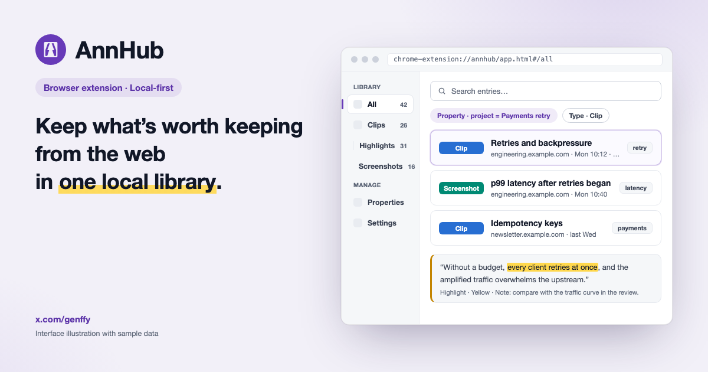

<!-- README.md (English, the default) and README.zh-CN.md (Chinese) are translations of each other: change both in the same commit. `pnpm run check:docs` compares their structure and checks the commands, paths, shortcuts and versions they state against the repository (linkage table in scripts/README.md). -->

# AnnHub

**English** | [简体中文](README.zh-CN.md)

[](https://github.com/genffy/annhub/actions/workflows/ci.yml)
[](https://scorecard.dev/viewer/?uri=github.com/genffy/annhub)
[](https://www.bestpractices.dev/projects/16415)
[](LICENSE)
[](https://chromewebstore.google.com/detail/jpooljigbeplpgciohfjklgbfdfnnmfn)

> Keep what’s worth keeping from the web in one local library.



AnnHub is a local-first browser extension for the material you read while you work. Select a passage, or point at a whole post or section, to clip it in one step; or drag to take a screenshot. Both are saved as entries together with their source. Later you read them in the library, highlight what matters, sort them with typed properties, search, jump back to the original page, or export them as Markdown.

[Add it to Chrome](https://chromewebstore.google.com/detail/jpooljigbeplpgciohfjklgbfdfnnmfn), or [try the library with sample data](https://annhub.org/en#library) without installing anything.

[Features](#features) · [Install](#install) · [Usage](#usage) · [Local-first and privacy](#local-first-and-privacy) · [Development](#development) · [Documentation](#documentation) · [Contributing](#contributing)

## Features

This is what the latest store release does. What is merged but not yet released is tracked in the [roadmap](docs/product/roadmap.md), and the contracts behind each feature are in [docs/product](docs/product/README.md) (both in Chinese).

- **Two ways to capture on the page.** Clip a selection, or point at a whole post, code block, table, figure, quote, section or article and save it as Markdown in one click; or take a screenshot of a region or an element. The page is never marked.
- **Highlights in the library.** Read a clip in the library, select the original text and highlight it with a colour and a note. A highlight is an annotation inside the clip, not a mark on the web page.
- **A source on every entry.** Each entry keeps its source URL (the permalink of the item in a feed), and selection clips also keep their surrounding context. Query parameters that carry tokens are stripped before saving, and “Back to source” opens the original page.
- **One entry format, typed properties.** Clips and screenshots share one storage format. Built-in properties (title, tags, author, publish date and more) are joined by your own typed ones: text, list, number, checkbox, date and date-time. The idea follows the Properties of Obsidian Web Clipper.
- **Screenshots.** Capture a region or an element, annotate in place (pen, highlighter, line, step numbers), mask identities and apply a mosaic, then copy to the clipboard or download; a watermark, aspect-ratio presets and a minimal beautify style apply to copies and downloads only. A scrolling capture stitches a long article into one image.
- **Page annotation.** Draw arrows, shapes, text and step numbers on the current tab. The ink follows the page as it scrolls, leaving the layer clears it, and you can send the ink straight into the screenshot editor.
- **Tab recording.** Record the current tab as a local MP4 file (WebM where the browser cannot record MP4), with optional microphone narration. Single-key ink and a cursor highlight can be added while recording, and both end up in the video.
- **Download.** Take a block, a page’s whole article, or the entries you select in the library out as a local Markdown folder or ZIP, media included.
- **Library.** Views for everything, clips, highlights, screenshots, properties and settings. Search and filter by type, tag or property; routes and filters live in the URL hash, so they survive a refresh, and a detail drawer edits titles, tags and notes.
- **One export.** A single ZIP of Markdown files, with properties as YAML frontmatter and highlights written as `==…==`, plus the saved original images, for reading in Obsidian and other tools. It is for reading elsewhere, not a backup that restores the AnnHub database.
- **Local-first.** Data lives in the browser’s IndexedDB, and capture, reading, search and export keep working offline. The interface comes in English and Chinese, in light and dark appearance.

## Install

Install AnnHub from the [Chrome Web Store](https://chromewebstore.google.com/detail/jpooljigbeplpgciohfjklgbfdfnnmfn). It needs Chrome 116 or later on desktop, or another Chromium-based desktop browser of the same version.

To run a build of your own, see [Development](#development).

## Usage

1. **Clip.** Select text on any page and choose **Clip** in the menu that appears. One click saves it, with no window opening; for about three seconds you can undo it or add tags and a note. Without selecting anything, rest the pointer on a block (post, code block, table, figure, quote, section or article) and choose **Clip** in the capsule that appears.
2. **Screenshot.** Choose **Screenshot** in the same menu, or use the shortcut below: drag a region or click an element, annotate in place, then save, copy or download it.
3. **Read and organise.** Open the library from the toolbar popup (**Open in library**), read a clip, select passages to highlight them, and add tags and properties.
4. **Find it again.** Search and filter in the library, and use **Back to source** to open the original page.
5. **Take it with you.** Export a Markdown ZIP from the library, or download the main article of a page as a Markdown folder.

### Keyboard shortcuts

| Action                                     | Windows, Linux, ChromeOS | macOS             |
| ------------------------------------------ | ------------------------ | ----------------- |
| Screenshot of a region or an element       | `Ctrl+Shift+S`           | `Command+Shift+S` |
| Block mode: pick a whole block and clip it | `Ctrl+Shift+E`           | `Command+Shift+E` |

Page annotation, tab recording and downloading a page’s article have no default shortcut: use the toolbar popup, or bind them at `chrome://extensions/shortcuts`.

## Local-first and privacy

- Entries, images, settings and local counters stay in the browser (IndexedDB and `chrome.storage`). There is no account, no AnnHub server and no AI service.
- Page text, URLs, titles and what you organise are never sent to AnnHub or to any third party.
- The extension reads only what you point at: a text selection, a block, a screenshot, or an explicit page download.
- The only outbound requests are made by the background after your click, to addresses the page itself references, without credentials and only to public addresses: the cross-origin images an element screenshot contains, and the media a Markdown-folder download declares.
- No remote code is loaded: extension pages run only the scripts the extension ships.

The permissions the extension asks for, and why, are listed in [permissions.md](docs/product/permissions.md) (Chinese). The public [privacy policy](https://annhub.org/privacy-policy.html) is bilingual.

## Scope

AnnHub follows one path: find something worth keeping, clip or screenshot it in one step together with its source, read it in the library and highlight what matters, then search it, go back to the source or export it. The browser extension does the capturing, organising and lookup.

Outside the product: team collaboration, a mobile app or a standalone desktop app, AI summaries and Q&A, general note-taking and whiteboards, a read-it-later inbox and full-page reader, highlights drawn on web pages, and full-page clipping with a template system. The full list and the reasons are in [product.md §2.3](docs/product/product.md) (Chinese).

### Data principles

1. Raw content, sources and your own organisation stay on your device by default.
2. A clip and a screenshot are two types of one entry. They share a source and properties, and the type never changes after creation. A highlight is an annotation inside a clip, not a type.
3. Properties are small and atomic: they are typed, one name always means one type, and long text goes in the note.
4. There is one user export: Markdown and the saved images as a ZIP, for reading in other tools. It cannot restore the AnnHub database.

## Architecture

```text
┌──────────────────────────────────────────────────────────┐
│ Browser extension                                        │
│ Selection menu / Block clip / Annotation layer           │
│ Screenshot session / Cursor highlight                    │
│ Library / Popup / Options / Offscreen document           │
└────────────────────────────┬─────────────────────────────┘
                             │ chrome.runtime.sendMessage
┌────────────────────────────▼─────────────────────────────┐
│ Background service worker                                │
│ Entries / Screenshot / Recording / Download / System     │
└────────────────────────────┬─────────────────────────────┘
                             │ domain API
┌────────────────────────────▼─────────────────────────────┐
│ core                                                     │
│ normalize / validate / query / store                     │
│ IndexedDB (annhub) / Markdown ZIP export                 │
└──────────────────────────────────────────────────────────┘
```

`core` is shared by the background, the content scripts, the library, the popup and the offscreen document. The background owns message permissions and task orchestration; reading images, exporting the whole library and packing downloads run in the environment of each entry point.

### Project structure

This is where the code lives today. It will evolve into a monorepo, and the target package layout is not fixed in the product docs.

```text
annhub/
├── entrypoints/                      # Extension entry points
│   ├── background/                   # Service worker entry
│   ├── content/                      # In-page capture and annotation: selection menu, block clip, screenshot session, annotation layer
│   │   ├── markdown.ts               # DOM → Markdown conversion
│   │   ├── blocks.ts                 # Recognition of the seven block types
│   │   ├── annotation/               # Page annotation layer and ink
│   │   └── screenshot/               # Region, element and scrolling capture, anonymising, editor
│   ├── library/                      # Library page: browse, read and highlight, properties, settings; builds the export ZIP
│   ├── offscreen/                    # Recording, on-demand article extraction, media fetch and packing for downloads
│   ├── options/                      # Options page
│   └── popup/                        # Toolbar popup: entry for annotation and recording, fallback on restricted pages
├── background-service/               # Message facade and browser services of the service worker
│   └── services/                     # One directory per service
│       ├── download/                 # Page and library downloads: orchestration, cancel, recovery
│       ├── entries/                  # Entries, properties, highlights and queries
│       ├── metrics/                  # Browser-storage adapter for local metrics
│       ├── recording/                # Tab recording orchestration and download
│       ├── screenshot/               # Capture, cross-origin image fetch, download
│       └── system/                   # Preferences and local metrics
├── core/                             # Shared domain core in pure TypeScript: rules, validation, queries, IndexedDB, Markdown ZIP export
├── types/                            # Message protocol
├── utils/                            # Shared helpers: interface strings, language, logging, formatting
├── locales/                          # Manifest strings (name, description, shortcut labels)
├── styles/                           # Shared design tokens
├── public/                           # Static files of the extension: icons and a sample page
├── assets/                           # Logo source
├── e2e/                              # Playwright tests against the built extension
├── tests/                            # Website tests that cross-check the docs and design tokens
├── scripts/                          # Repository checks and smoke scripts
├── docs/                             # Product docs, design prototypes and review findings
├── website/                          # Landing page: Next.js, static export on Cloudflare
├── cloudflare/                       # Website deployment settings and edge rules
├── .github/                          # CI, release and security workflows, rulesets
├── .agents/                          # Agent skills and harness notes
├── .claude/                          # Claude Code settings, hooks and skills
├── .vscode/                          # Recommended editor extensions
├── AGENTS.md                         # Engineering conventions
└── wxt.config.ts                     # Manifest, permissions and shortcuts
```

Engineering conventions start at [AGENTS.md](AGENTS.md), with the details in the `AGENTS.md` of each directory. Product positioning, data contracts and the roadmap start at [docs/product/README.md](docs/product/README.md).

## Development

### Requirements

- Node.js 24.x or later
- pnpm; the version is pinned by `packageManager` in `package.json`
- Chrome or Chromium (the minimum version is under [Install](#install))

### Build and load

```bash
pnpm install
pnpm run dev       # watch mode, output in .output/chrome-mv3-dev/
pnpm run build     # production build, output in .output/chrome-mv3/
pnpm run zip       # Chrome Web Store package
pnpm run compile   # type check
```

Open `chrome://extensions/`, turn on Developer mode, choose **Load unpacked** and select the output directory.

### Test and verify

```bash
pnpm run verify                           # format, ESLint, types, unit tests with coverage, docs checks, file-size budgets, lockfile registry, consistency
pnpm exec playwright install chromium     # once, before the first E2E run
pnpm run test:e2e                         # Playwright against the built extension; rebuilds it when it is stale
```

`pnpm run format` fixes formatting in one go. CI (`.github/workflows/`) runs the same commands plus CodeQL, dependency review and workflow lint; the merge gate is `ci-pass` plus the checks listed in `.github/rulesets/main.json`. What each check does is in [scripts/README.md](scripts/README.md), and manual testing in a real Chrome is in [e2e/README.md](e2e/README.md).

### Website

The landing page lives in `website/` (Next.js, exported as static files and served by Cloudflare Workers Static Assets). `pnpm run website:dev`, `pnpm run website:build` and `pnpm run website:start` run it; the details are in [website/README.md](website/README.md).

<details>
<summary>For maintainers: releasing and repository settings</summary>

- **Release:** tag a commit `v<version in package.json>`. `release.yml` first runs the full gate, then builds, checks that the manifest version matches the tag, generates a build-provenance attestation and creates the GitHub Release. If the tag already has a Release (a draft included), it only replaces the attachments and leaves the publish state alone, so a draft has to be published by hand. Uploading to the Chrome Web Store is a manual step; the assets and disclosure requirements are in [permissions.md](docs/product/permissions.md).
- **One-time repository settings** that workflow files cannot replace: import `.github/rulesets/main.json` (Settings → Rules → Rulesets → Import; let every required check run once on a pull request first, or GitHub cannot find the check names); under Actions, set the default token to read-only, require actions to be pinned to a full commit SHA and require approval for fork pull-request workflows; under Code security, turn on secret scanning with push protection, Dependabot alerts and security updates, and private vulnerability reporting.

</details>

## Documentation

The product and engineering documents are written in Chinese.

- [Product docs](docs/product/README.md): the entry point and document map
- [Product positioning](docs/product/product.md)
- [Entry data contract](docs/product/entry.md)
- [Roadmap](docs/product/roadmap.md): what is released and what is in progress, the only source of delivery status
- [Open decisions, risks and questions](docs/product/validation.md)
- [Screenshot capture design](docs/product/screenshot.md)
- [Permissions and data boundary](docs/product/permissions.md)
- [UX/UI design prototypes](docs/design/README.md)
- [Security policy](SECURITY.md)

## Contributing

Issues and pull requests are welcome.

- **Ideas and bugs:** open a [GitHub issue](https://github.com/genffy/annhub/issues). Candidate features are issues labelled `enhancement`; the product owner picks one to build and lists it in the [roadmap](docs/product/roadmap.md).
- **One feature, one pull request:** the spec in [docs/product](docs/product/README.md), the user stories and acceptance criteria, the metrics, the code and the tests change together. The flow is in [docs/product/AGENTS.md](docs/product/AGENTS.md), and a feature that crosses the not-doing list in [product.md §2.3](docs/product/product.md) changes that row in the same pull request.
- **Before you push:** run `pnpm run verify` and fill in the [pull request template](.github/pull_request_template.md).
- **Conventions:** [AGENTS.md](AGENTS.md) is the entry point of the engineering conventions, for people and for coding agents alike. Commits follow [Conventional Commits](https://www.conventionalcommits.org/).
- **Keep the two READMEs in sync:** `README.md` and `README.zh-CN.md` are translations of each other, so a change to one is made in both, in the same commit. `pnpm run check:docs` checks that their structure still matches and that the commands, paths, shortcuts and versions they state still match the repository.

## Security

Report vulnerabilities privately through GitHub (**Security → Report a vulnerability**) and do not open a public issue; see [SECURITY.md](SECURITY.md). Release zips carry a build-provenance attestation: `gh attestation verify <zip> --repo genffy/annhub`.

## License

[MIT](LICENSE)
